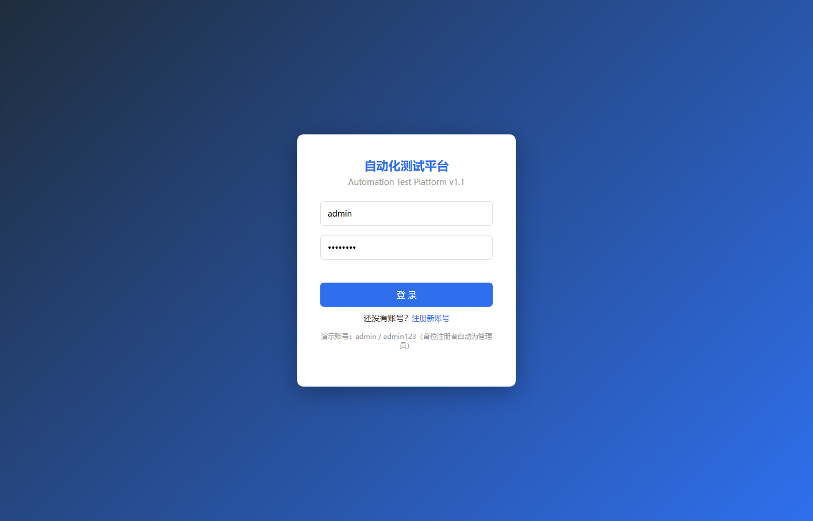
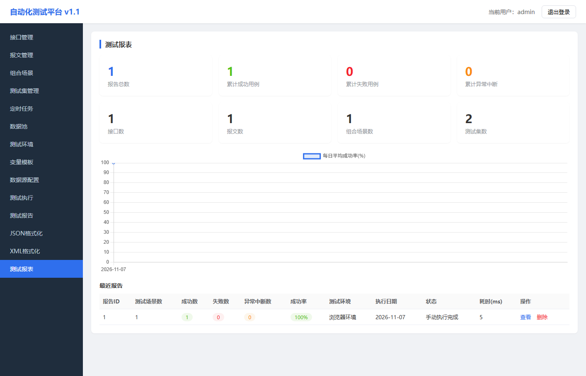
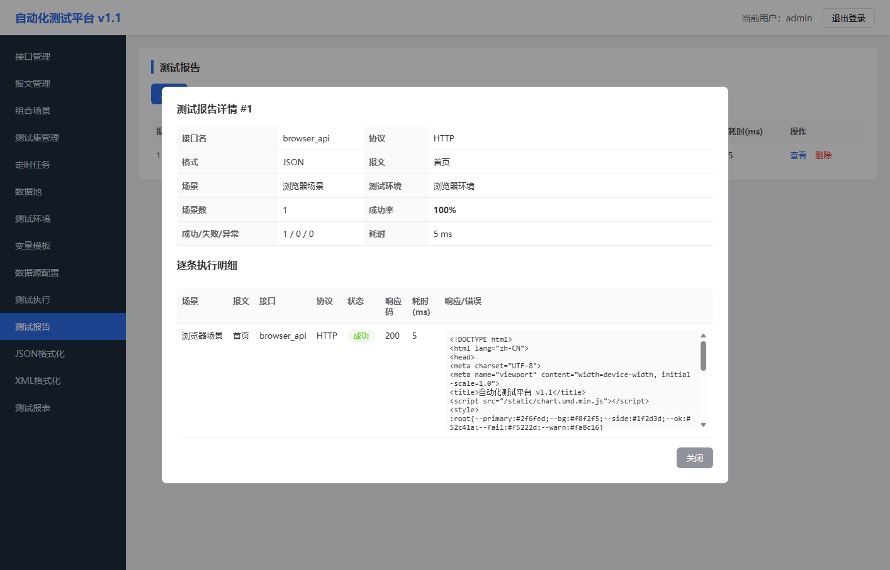

# 自动化测试平台

一个轻量的接口自动化测试平台：把接口、报文、组合场景、测试集、测试环境和测试报告放在一个地方管理，支持真实 HTTP/HTTPS/TCP 执行、定时任务和可视化报表。

- GitHub 仓库：<https://github.com/fuyue-1/autotest-platform>
- 在线演示（开启 GitHub Pages 后）：<https://fuyue-1.github.io/autotest-platform/>
- 演示账号：`admin / admin123`

---

## 背景：这个系统是做什么的

接口测试的过程中，接口地址、请求报文、多个接口的组合场景、测试集、不同环境的 IP/代理、测试数据往往分散在文档、脚本和聊天记录里；执行完以后，结果也很难汇总和追踪。

这个系统把这条链路串了起来：

1. 在“接口管理”中登记接口；
2. 在“报文管理”中保存请求方法和报文内容；
3. 在“组合场景”中把多条报文组织成一个业务流程；
4. 在“测试集管理”中用目录 / 测试集组织场景；
5. 在“测试环境”中配置目标地址、协议和代理；
6. 在“测试执行”中选择测试集和环境，执行测试；
7. 在“测试报告”中查看成功、失败、异常和逐条响应；
8. 在“测试报表”中查看成功率和趋势；
9. 通过“定时任务”让测试集按 cron 自动执行。

另外还提供变量模板、数据池、数据源配置、JSON 格式化、XML 格式化等辅助能力。

---

## 先看效果







---

## 功能一览

| 模块 | 能做什么 |
|---|---|
| 用户登录 | 登录、注册、退出；刷新页面自动恢复会话 |
| 接口管理 | 接口增删改查、搜索，维护接口类型、协议和状态 |
| 报文管理 | 保存 `METHOD URL + Header + Body` 报文，支持 `${变量}` 替换 |
| 组合场景 | 把多条报文组合成一个业务场景，支持独立客户端标记和备注 |
| 测试集管理 | 目录 / 测试集树形结构，支持父目录、关联场景和删除保护 |
| 测试环境 | 配置目标 IP/域名、协议（HTTP/HTTPS/TCP/SOAP）和代理 |
| 测试执行 | 真实发送 HTTP/HTTPS/SOAP 请求或建立 TCP 连接，生成报告 |
| 测试报告 | 查看场景数、成功/失败/异常、成功率、耗时和逐条执行明细 |
| 定时任务 | 标准 5 段 cron，后台调度，记录执行次数和最后执行时间 |
| 测试报表 | 汇总卡片、每日平均成功率趋势图、最近报告 |
| 变量模板 | 全局变量，支持 `${base_url}`、`${env.ip}` 等 |
| 数据池 | CSV / Excel / SQL 结果集数据池管理 |
| 数据源配置 | MySQL / Oracle / SQLServer / PostgreSQL 连接信息管理，密码不回显 |
| JSON 格式化 | 格式化、压缩、合法性校验 |
| XML 格式化 | 格式化、压缩、合法性校验 |

---

## 快速体验

### 方式一：在线演示（GitHub Pages）

开启 GitHub Pages 后，直接打开：

**<https://fuyue-1.github.io/autotest-platform/>**

使用 `admin / admin123` 登录即可看到完整界面和示例数据。

> **说明**：GitHub Pages 只能托管静态文件，不能运行 Python/Flask 后端。因此在线演示使用浏览器本地数据（localStorage）模拟接口、执行和报告；执行结果为前端模拟，不会向真实服务器发送请求，也不会运行真实后台定时任务。
>
> 如果需要真实发送 HTTP/TCP 请求、使用 SQLite 持久化和真实定时任务，请使用下面的“本地运行”。

### 方式二：本地运行完整后端

环境要求：Python 3.9+。

```bash
git clone https://github.com/fuyue-1/autotest-platform.git
cd autotest-platform
pip install -r requirements.txt
python app.py
```

浏览器打开 **<http://127.0.0.1:8080>**。

Windows 也可以直接双击 `start.bat`；Linux/macOS 可以执行：

```bash
chmod +x start.sh
./start.sh
```

演示账号：

```text
admin / admin123
```

首次启动会自动创建 `autotest.db` 和默认管理员。登录后建议先修改默认密码。

---

## 本地版和在线演示的区别

| 能力 | GitHub Pages 在线演示 | 本地运行 Flask |
|---|---|---|
| 查看和操作完整界面 | ✅ | ✅ |
| 接口/报文/场景/测试集管理 | ✅ | ✅ |
| 数据保存 | 浏览器 localStorage | SQLite `autotest.db` |
| 真实 HTTP/HTTPS 请求 | ❌ 模拟 | ✅ |
| 真实 TCP 连接 | ❌ 模拟 | ✅ |
| 真实 cron 定时执行 | ❌ 模拟 | ✅ |
| 多用户/服务端会话 | ❌ 单浏览器 | ✅ |
| 数据源密码保护 | 演示数据 | 后端不回显密码 |

如果只是想把界面放到 GitHub Pages 给同学或面试官看，用在线演示即可；如果要做真实的接口测试，请在本地或服务器上运行 Flask。

---

## 使用流程

```text
变量模板（可选，先建 base_url）
        ↓
接口管理
        ↓
报文管理（METHOD URL + Header + Body）
        ↓
组合场景（关联多条报文）
        ↓
测试集管理（目录 / 测试集，关联场景）
        ↓
测试环境（IP、协议、代理）
        ↓
测试执行
        ↓
测试报告 / 测试报表
        ↓
定时任务（cron 自动执行）
```

### 报文格式

“报文内容”按下面格式填写：

```text
GET /api/user/list
```

带请求头和请求体：

```text
POST /api/login
Content-Type: application/json
X-Token: abc123

{"username":"admin","password":"admin123"}
```

规则：

- 第一行是 `METHOD URL`，方法支持 `GET/POST/PUT/DELETE/PATCH/HEAD/OPTIONS`；
- URL 可以写完整地址，也可以写 `/path`，相对路径会拼接测试环境的 `协议://IP`；
- 第二行开始可以写请求头，空行之后是请求体；
- 支持变量 `${base_url}`、`${env.ip}`、`${env.name}` 等；
- 测试环境协议为 `TCP` 时，报文内容会作为原始字节发送。

---

## GitHub Pages 部署

仓库已经包含根目录的 `index.html` 和 `.nojekyll`，可以直接从 `main` 分支根目录发布。

1. 打开仓库 **Settings → Pages**。
2. **Build and deployment → Source** 选择 **Deploy from a branch**。
3. Branch 选择 **main**，目录选择 **/(root)**，点击 **Save**。
4. 等待 1–2 分钟，访问：

   **<https://fuyue-1.github.io/autotest-platform/>**

如果打开是 404，检查：

- 仓库是否为 Public（私有仓库的 Pages 需要付费方案）；
- Pages 的分支是否为 `main`，目录是否为根目录；
- 根目录是否存在 `index.html` 和 `.nojekyll`；
- 是否刚保存，稍等一会儿再刷新。

---

## 项目结构

```text
autotest-platform/
├─ index.html              # GitHub Pages 入口（静态演示）
├─ .nojekyll               # 让 GitHub Pages 原样托管 static 等目录
├─ app.py                  # 完整 Flask 后端（本地/服务器运行）
├─ requirements.txt        # Python 依赖
├─ start.bat               # Windows 一键启动
├─ start.sh                # Linux/macOS 一键启动
├─ screenshots/            # README 截图
└─ static/
   ├─ index.html           # Flask 页面模板
   ├─ app.js               # 前端交互
   ├─ demo.js              # GitHub Pages 演示模式（localStorage 模拟）
   └─ chart.umd.min.js     # Chart.js 本地文件
```

`app.py` 负责建表、登录鉴权、CRUD、HTTP/TCP 执行、报告、cron 调度和报表；前端不依赖 Node 或打包工具。

---

## 技术栈

- 后端：Python 3、Flask、SQLite
- 前端：原生 HTML/CSS/JavaScript、Chart.js（本地引入，不依赖外网）
- 执行：requests（HTTP/HTTPS/SOAP）、socket（TCP）
- 调度：croniter + 后台线程
- 部署：GitHub Pages（静态演示）+ 任意 Python 环境（完整后端）

---

## 数据与安全

- 本地版数据保存在项目目录的 `autotest.db`，备份时复制该文件即可。
- 用户密码使用 Werkzeug scrypt 哈希保存，不存明文。
- 数据源密码不会通过列表/详情接口回传；编辑时留空表示不修改。
- 生产环境请修改默认管理员密码，并设置环境变量 `AUTOTEST_SECRET` 作为 session 密钥。
- 平台会向“测试环境”中配置的地址发送真实请求，请只在授权环境使用；HTTPS 请求默认跳过证书校验。
- 在线演示的数据只保存在当前浏览器，清除浏览器站点数据或点击登录页的“重置演示数据”即可恢复初始示例。

---

## 常见问题

**Q：GitHub Pages 打开后能真实执行接口测试吗？**

不能。Pages 是静态托管，不能运行 Flask/Python；在线演示的执行结果是前端模拟。真实执行请本地运行 `python app.py`。

**Q：在线演示的数据会丢吗？**

数据保存在当前浏览器的 localStorage 中，换浏览器、无痕模式或清除站点数据后会回到初始示例。

**Q：本地启动提示端口被占用？**

设置环境变量后重新启动：

```bash
# Windows
set AUTOTEST_PORT=8081
python app.py

# Linux/macOS
AUTOTEST_PORT=8081 python app.py
```

**Q：执行测试全部是“异常”？**

打开报告详情查看“响应/错误”。常见原因是测试环境 IP/端口填错、目标服务未启动、URL 不是以 `/` 开头、变量未定义或代理配置错误。

**Q：定时任务没有执行？**

检查任务是否为“开启”、cron 是否为标准 5 段、测试集是否关联了场景、测试环境是否存在；启动时如果设置了 `AUTOTEST_SCHEDULER=0`，后台调度会被关闭。

---

## License

本项目用于学习、课程设计和演示用途，可自行修改和扩展。
